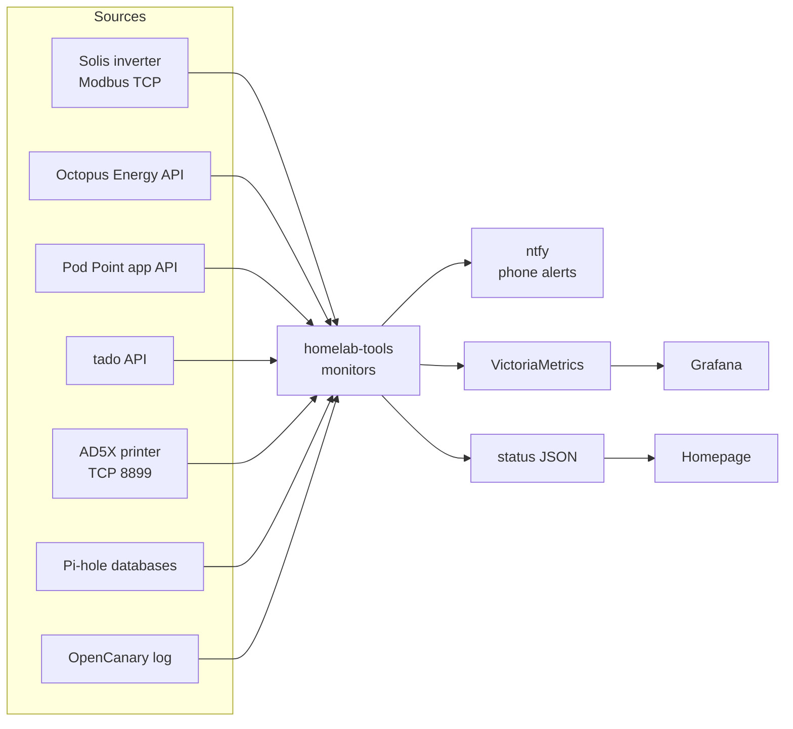

# homelab-tools

Small, **read-only** monitors for a home lab: energy (Octopus Energy, Solis inverters, Pod Point
chargers), heating (tado°), a FlashForge AD5X 3D printer, and two security helpers for Pi-hole and
OpenCanary - plus backup tools (snapshots and restore tests) and a Pi-hole failover recipe.

They are plain Python (standard library only, except the Pod Point monitor), run as systemd services,
and publish to three optional, interchangeable outputs:

* **ntfy** push notifications to your phone,
* **VictoriaMetrics** time series for **Grafana** graphs,
* small **status JSON** files for a dashboard such as **Homepage**.

No Home Assistant required. Nothing here changes a device's settings.



## Tools

| Tool | What it does | Doc |
|---|---|---|
| `octopus-collector` | Prices every half-hour of Octopus Energy usage at the exact tariff rate (import, export, gas, standing charges), backfills history, estimates solar/battery savings | [octopus](docs/octopus.md) |
| `solis-monitor` | Reads a Solis hybrid inverter locally over Modbus TCP: solar, battery, grid, house, faults | [solis](docs/solis.md) |
| `podpoint-monitor` | Real charger state ("waiting for 00:30", not just "charging"), session energy and cost, alerts | [podpoint](docs/podpoint.md) |
| `tado-monitor` / `tado-auth` | Room temperatures, targets, heating demand, weather; battery-low and offline alerts | [tado](docs/tado.md) |
| `ad5x-monitor` | FlashForge AD5X job progress, finish-time estimate, temperatures; alerts for start / finish / pause / power loss mid-print | [ad5x](docs/ad5x.md) |
| `solar-forecast` | Today's and tomorrow's expected solar generation from Forecast.Solar | [solar-forecast](docs/solar-forecast.md) |
| `solar-health` | Daily: a dead or weakening solar string, a week of generation well below forecast, battery health falling | [solar-health](docs/solar-health.md) |
| `battery-check` | Morning alert if the battery didn't charge overnight; evening heads-up when tomorrow's solar won't carry the house to the cheap rate | [battery-check](docs/battery-check.md) |
| `weekly-report` | Monday-to-Sunday energy summary to your phone: bill, solar, car, heating, vs. the week before | [weekly-report](docs/weekly-report.md) |
| `pihole-threat-alert` | Alerts when a device looks up a domain on a threat-intelligence list | [pihole-threat-alert](docs/pihole-threat-alert.md) |
| `opencanary-ntfy` | Turns OpenCanary honeypot logs into readable, rate-limited alerts | [opencanary-ntfy](docs/opencanary-ntfy.md) |
| `tariff-compare` | Monthly: last month's real half-hourly use priced on other Octopus tariffs (Agile, Flux, Go, fixed...), with battery/EV charging moved to each tariff's cheap times | [tariff-compare](docs/tariff-compare.md) |
| `octopus-sessions` | Alerts when Octopus announces Power Down / Power Up sessions or free-electricity events, and reports each joined session's result (including "missing readings") | [octopus-sessions](docs/octopus-sessions.md) |
| `usage-watch` | Daily: gas use out of line with the weather, or an always-on electricity load that has jumped | [usage-watch](docs/usage-watch.md) |
| `host-health` | Every 5 min: server heat, under-voltage, failed services, memory, disks, SD-card wear, pending reboots | [host-health](docs/host-health.md) |
| `powerline-monitor` | Every 5 min: devolo powerline link speeds, adapters offline, restarts and firmware updates | [powerline-monitor](docs/powerline-monitor.md) |
| `restic-restore-test` | Monthly proof that the restic backup restores: a random sample, byte-compared with the originals, databases checked | [restic-restore-test](docs/restic-restore-test.md) |
| `scripts/ssh-login-alert` | Phone alert for every SSH login, from PAM, never delaying the login | [ssh-login-alert](docs/ssh-login-alert.md) |
| `scripts/sqlite-snapshot-backup` | Daily hard-link snapshots with consistent copies of live SQLite databases | [sqlite-snapshot-backup](docs/sqlite-snapshot-backup.md) |
| `examples/keepalived` | Two Pi-holes sharing one DNS address, with automatic failover | [pihole-failover](docs/pihole-failover.md) |

Ready-made Grafana dashboards and a Homepage layout are in [`examples/`](examples) - see
[docs/dashboards.md](docs/dashboards.md).

## Quick start

```sh
sudo python3 -m venv /opt/homelab-tools
sudo /opt/homelab-tools/bin/pip install "homelab-tools[podpoint] @ git+https://github.com/zgf6wfh2vf-max/homelab-tools"
sudo install -d -m 750 /etc/homelab-tools
sudo cp examples/env/solis-monitor.env.example /etc/homelab-tools/solis-monitor.env   # then edit it
sudo cp examples/systemd/solis-monitor.service /etc/systemd/system/
sudo systemctl enable --now solis-monitor
```

The full walkthrough (service user, status directory, VictoriaMetrics + Grafana, timers) is in
[docs/installation.md](docs/installation.md).

## Design principles

* **Read-only.** Every tool only reads from devices and services. The Modbus client implements reads
  only; the cloud clients only call read endpoints.
* **Configuration from the environment.** No hosts, tokens or topics in code; secrets live in files
  readable only by the service user.
* **Fail quietly, alert loudly.** A monitor never crashes because a device is offline or an output is
  unreachable; it logs and retries. Alerts are de-duplicated so you are told once.
* **Pure logic, tested.** Parsing, pricing, state machines and alert decisions are plain functions
  covered by unit tests; network and file I/O sit at the edges and are injected in tests.

## Development

```sh
python3 -m venv .venv && .venv/bin/pip install -e ".[dev]"
.venv/bin/pytest            # unit tests (+ the backup script, needs rsync and sqlite3)
.venv/bin/ruff check . && .venv/bin/ruff format --check .
.venv/bin/mypy              # strict type checking
shellcheck scripts/* examples/keepalived/*-*
```

See [CONTRIBUTING.md](CONTRIBUTING.md).

## Caveats

* The **Pod Point** and **tado** integrations use APIs their vendors do not officially support for
  third parties (tado does support the device login flow). They may change without notice.
* **Octopus** smart-meter data arrives one to two days late; "latest day" figures lag accordingly.
* Gas kWh are converted from m³ with a typical calorific value - close, but not your bill's exact figure.

## Licence

MIT - see [LICENSE](LICENSE).
